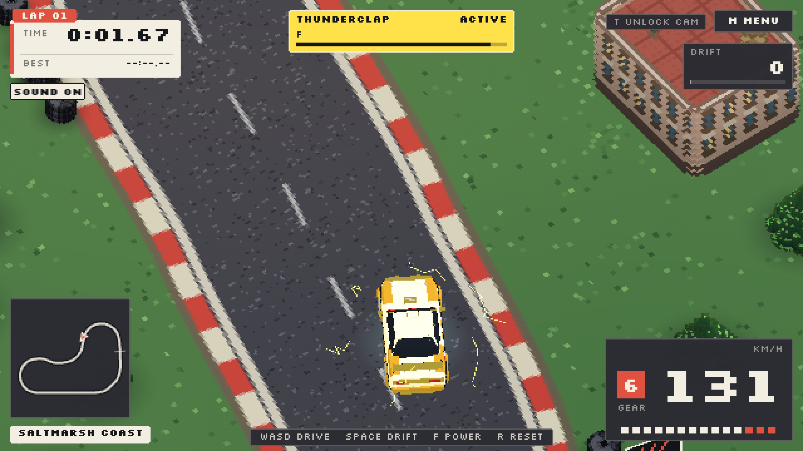
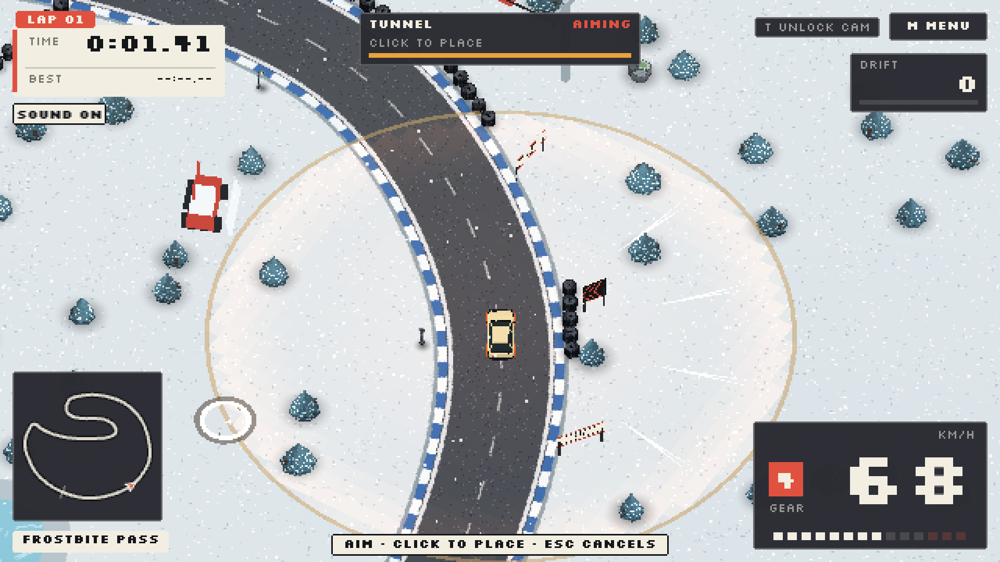
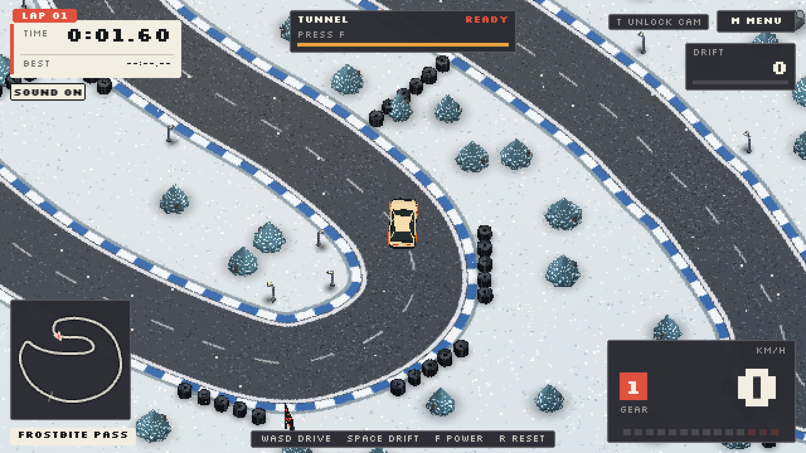
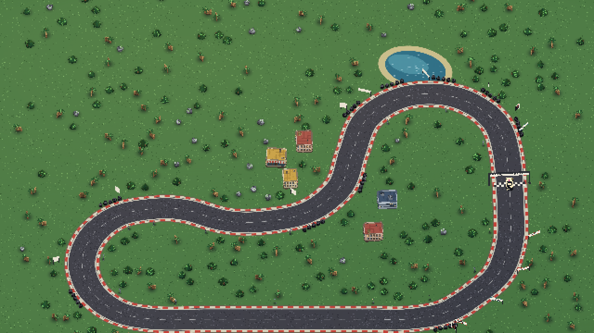
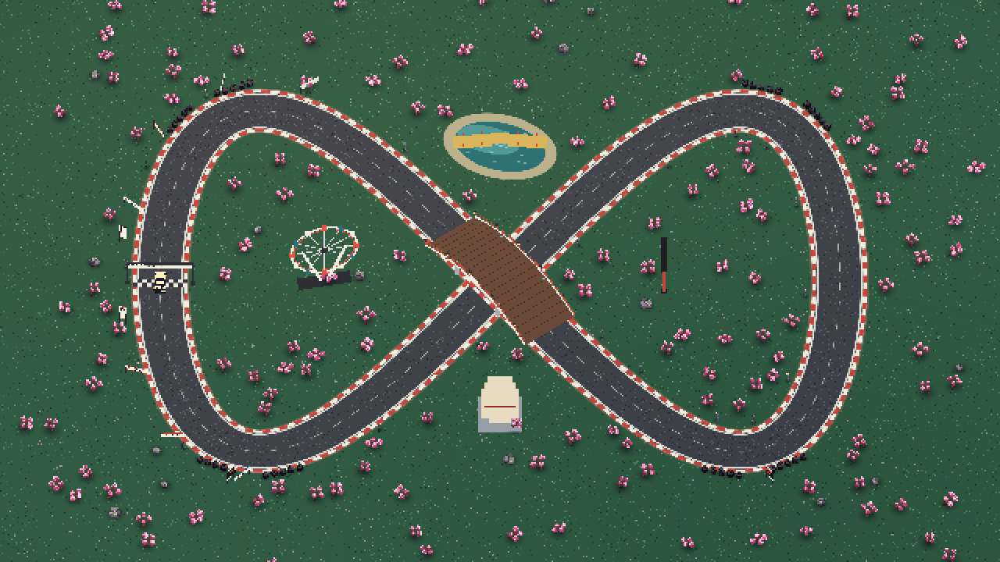

# Pixel Drift

A 2D pixel sprite art racer with powers.

Play it live at **[drift.lucasian.tech](https://drift.lucasian.tech)**


| | |
| --- | --- |
|  |  |
|  |  |

## WHY THIS EXISTS

I realised I had never made a game before, and a 2D pixel game was a really
cool idea that I wanted to pursue.

## Cool Features

- Each car has a unique design, stats and power
- The maps are detailed and challenging
- The leaderboard for each map creates competitiveness
- Anti-cheat mechanisms keep the game honest
- A camera lock feature which trails directly behind the car
- A ghost car that traces the best player's route on the map

## Future Features

- More cars such as the Tesla Roadster
- More maps
- Multiplayer shouldn't be too far of a stretch, since accounts already exist
- A progression system where you unlock cars and maps based on achievements

## THE CARS AND THEIR POWERS

| Car | Power | What it does |
| --- | --- | --- |
| **Pearl GT** | Pearl Drift | 5s of loose rear grip and a ×3.5 drift score; 9.2s cooldown |
| **Group B** | Thunderclap | 3s of ×1.38 top speed and ×2.2 acceleration; 8s cooldown |
| **Dune Runner** | Tunnel | Place the car anywhere within a 22 m radius; 7.2s cooldown |


## THREE CIRCUITS

| | |
| --- | --- |
| **Saltmarsh Coast** - a technical circuit with a lake, pines and palms | **Frostbite Pass** - a big snow circuit with snow pines, a frozen lake and falling snow |
|  |  |
| **Sakura Circuit** - a Japanese-themed figure-eight with sakura trees, torii and an overpass | |
|  | |


## PROBLEMS I HAD TO FIX

- **Cheating.** Players could cut the circuit where it folds back on itself
  and post times their car could never reach. To solve this a successful lap now has to come near
  every stretch of the circuit, however this can cause problems with Dune Runner's ability tunnel and future teleporting powers.
- **Lost laps.** A lap might not send due to connection issues which the game solves by unsent laps kept in the
  browser and re-send it after the next save.

## RUN IT

```sh
# 1. clone the repo
git clone https://github.com/lucasian-max/pixel-drift.git && cd pixel-drift

# 2. install
npm install

# 3. start the API (accounts, leaderboard, lap validator)
npm run api        # 127.0.0.1:8790

# 4. start the game (in another terminal)
npm run dev        # http://127.0.0.1:5180

# or build the production bundle
npm run build

# or run the test suite (validator fixtures + car stats)
npm test
```

The game runs without the API however you just can't save lap times.

### Controls

| Action | Keys |
| --- | --- |
| Drive | WASD / arrows |
| Handbrake drift | Space |
| Superpower | F |
| Look around | Q / E or drag |
| Re-lock the chase camera | T |
| Zoom | mouse wheel |
| Pick car / circuit on the title | Up/Down, Left/Right |
| Swap car at the start line | C |
| Back to the title | M |
| Reset | R |
| Pause | P or Esc |
| Mute | N |

## AI DISCLOSURE

AI was used to help implement the server, the accounts and
leaderboard. The design of the game was entirely mine.
