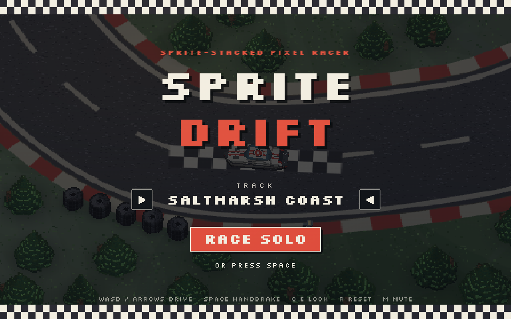
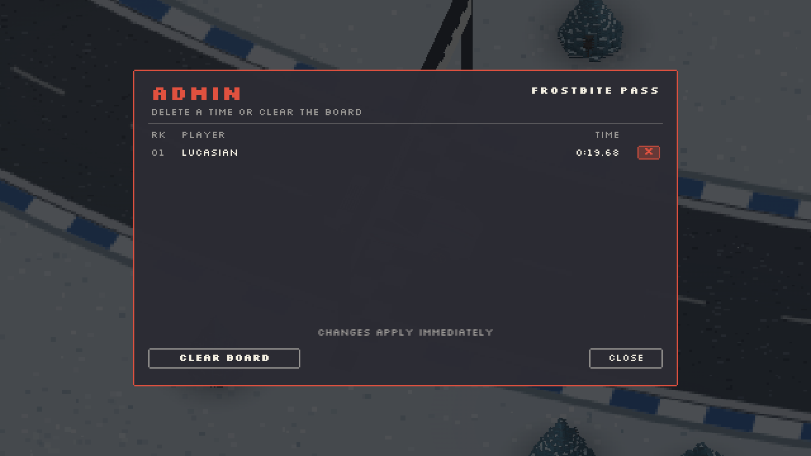
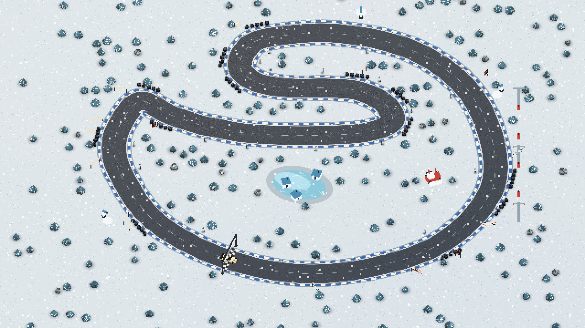
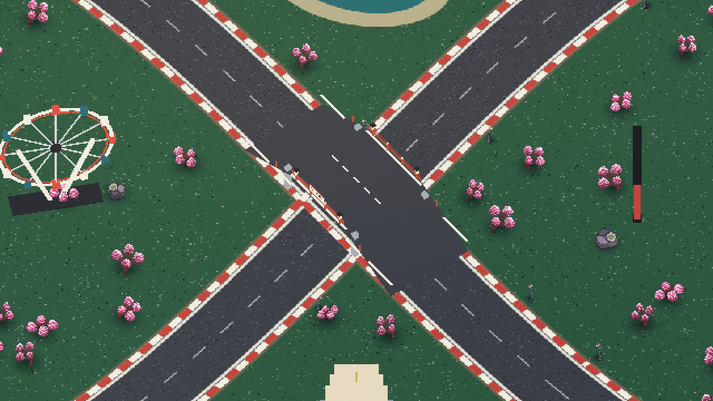
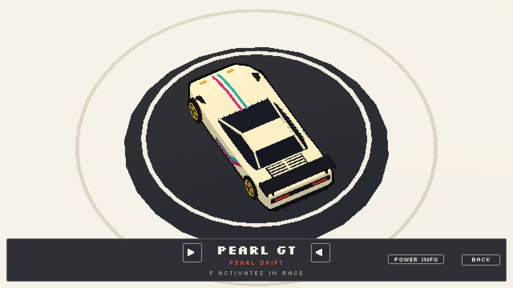
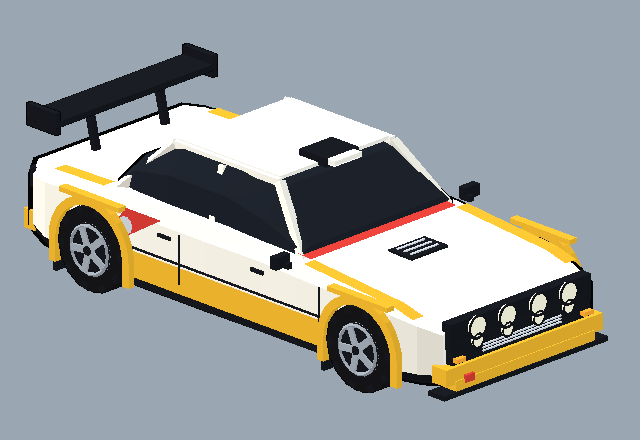
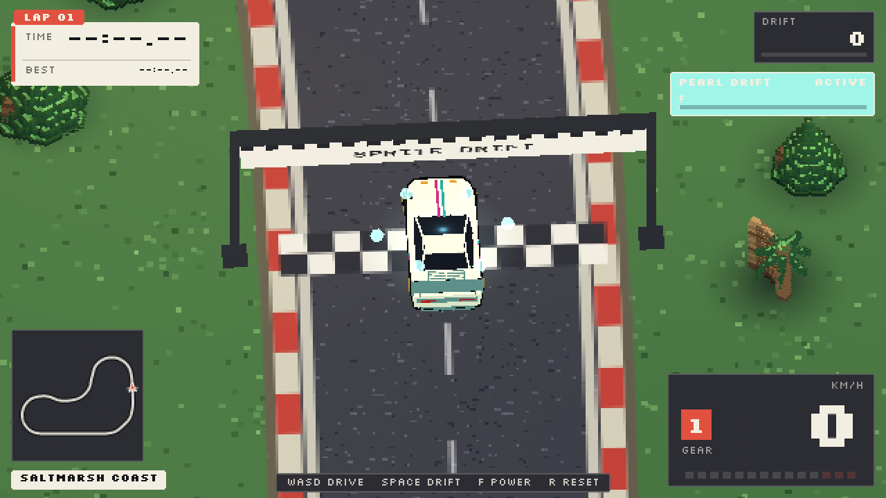

# Pixel Drift

A pixel-art racer built on **sprite stacking**: every car and prop is a stack of
flat pixel slices drawn one pixel apart, so a 2D sprite turns like a 3D model.



## Play

```bash
npm install
npm run dev      # http://127.0.0.1:5180
```

| Action | Keys |
| --- | --- |
| Drive | WASD / arrows |
| Handbrake drift | Space |
| Superpower | F |
| Look around (manual orbit) | Q / E or drag |
| Re-lock the chase camera | T |
| Zoom | mouse wheel |
| Pick car / circuit on the title | Up/Down, Left/Right |
| Swap car at the start line | C (before the lap timer starts) |
| Back to the title, mid-run too | M |
| View the car turntable | VIEW CAR on the title |
| Read the selected power | POWER INFO on the title |
| Reset | R |
| Pause | P or Esc |
| Mute | N |

The race camera sits behind the car and follows it around corners. Q/E,
dragging or the wheel make it manual; T re-locks the chase.

## Record runs for an AI model

Every timed lap is recorded at 60 Hz (state + the exact controls), plus the
launch from the grid, impact/power/reset events, player, input device and
off-track time. Nothing about it is shown in the HUD. Developer keys: `V`
toggles recording, `X` downloads all stored laps as JSONL; both only log to the
console. Add `?rec=120` for 120 Hz samples.

Every saved episode from signed-in players — complete or partial — uploads
automatically to the game server, labelled with `complete`, `partial`,
`launch`, stats and events. Guests stay local. The server only stages raw files
until the **private Hugging Face dataset** sync runs every minute, then deletes
the local copy. The browser also drops its copy after the server accepts it, so
recordings don't pile up on either side.
`tools/dataset/convert_runs.py` turns that into Parquet + NPZ with
track-relative observations, episode metadata, normalisation stats and a
train/val split; `tools/dataset/train_bc.py` is a ridge and MLP behaviour-
cloning baseline. The admin panel can also **UPLOAD RUNS** manually; merge
uploads with `tools/dataset/merge_runs.py` before converting. See
[`tools/dataset/README.md`](tools/dataset/README.md) for the schema, storage,
why Parquet (LeRobot-style), and training notes.

Private Hugging Face sync:

```bash
echo 'hf_...' > server/data/hf-token && chmod 600 server/data/hf-token
server/.venv/bin/python tools/hf_sync.py      # creates <you>/pixel-drift-runs privately
ln -sf "$PWD/deploy/pixel-drift-hf-sync.service" ~/.config/systemd/user/
ln -sf "$PWD/deploy/pixel-drift-hf-sync.timer" ~/.config/systemd/user/
systemctl --user daemon-reload
systemctl --user enable --now pixel-drift-hf-sync.timer
```

Runs land under `raw/<player>/` in the private dataset. Override the repo with
`HF_DATASET=you/other-name` or `server/data/hf-dataset`.

## Online rooms — archived

Multiplayer is mothballed for this release. The complete implementation is on
the `multiplayer` branch and `multiplayer-archive` tag (see
[`docs/multiplayer.md`](docs/multiplayer.md)); the shipped build is solo only.

## Accounts and leaderboard

Sign in on the title to post lap times. Each circuit has its own board: the
best lap per player, top 10. Times are trusted as submitted; a position trace
is kept for replays but is not used to reject a lap.

Admin names come from `SPRITE_ADMINS` or the gitignored
`server/data/admins.json`; admin accounts get an **ADMIN** button on the title
for deleting a time or clearing a circuit board, plus a **DASHBOARD** link to
`/dashboard.html`.



See [`server/README.md`](server/README.md#admin-accounts).

New laps are checked server-side against the circuit before they reach the
board: the lap trace is required and must start/finish at the line, cover the
route, stay near the road and contain no impossible speeds. Shortcuts and
teleports are rejected with a reason.

The API runs as a local user service on `127.0.0.1:8790` (Vite proxies `/api`
to it). Use `SPRITE_API=http://host:port` to point a dev server elsewhere. See
[`server/README.md`](server/README.md).

## Data desk

Signed-in admins can open `/dashboard.html`, or hit **DASHBOARD** in the in-game
admin panel. It shows the laps gathered so far: per-circuit boards, total
laps and drivers, the fastest lap, recent submissions and the local 60 Hz
recorder runs from this browser. New laps are validated server-side against
the real circuit — the rules are in
[`server/README.md`](server/README.md#lap-submission-and-anti-cheat).


## Three circuits

| | |
| --- | --- |
| **Saltmarsh Coast** — green, a lake, pines and palms | **Frostbite Pass** — a big snow circuit with blue kerbs and a wide infield hairpin, snow pines, a frozen lake with ice huts, a ski lift, snow cannons, a snowcat and falling snow |
|  |  |
| **Sakura Circuit** — a Japanese forest figure-eight with sakura trees, kanji signage, torii, a pagoda, a red garden bridge and a drivable overpass | |
|  | |

Pick a circuit on the title screen with the arrows, or link straight to one:
`?map=coast|alpine|sakura`.

Sakura detail: sakura trees, kanji boards and the drivable overpass.




## The cars and their powers

The garage is being cut to three. Right now it holds Pearl GT and the Group B
rally car; the third slot is waiting for the car chosen from the next sheet.
Choose with the car arrows on the title. Every car has one power on the `F`
key; the HUD card shows READY, ACTIVE and the cooldown. VIEW CAR opens a white
studio turntable.
`VIEW CAR` opens a turntable, and `POWER INFO` explains the selected power.



| Car | Power | What it does |
| --- | --- | --- |
| **Pearl GT** | Pearl Drift | 4.5s of loose rear grip, a ×3.5 drift score and a boost on exit; 8s cooldown |
| **Group B** | Thunderclap | 3.5s of ×1.5 top speed, ×2.6 acceleration and a launch burst; 7s cooldown |

The hero is a pearl-white GT with a twin racing stripe, a roof roundel, framed
glass, mirrors, vented bonnet, a ducktail spoiler and chrome exhausts.


The Group B car is a yellow-and-white rally coupe built from a four-view sheet:
boxy flares, a six-lamp pod, roof scoop, mudflaps and a tall rear wing.






Adding a car? The project copy of the agent skill is
[`docs/pixel-car-stack.md`](docs/pixel-car-stack.md): the four-view sheet → 3D model
contract, the stack-atlas path, the Opus 5.5 prompt, and the screenshot/verification
recipe.

## How the art works

`scripts/gen-assets.mjs` authors each object as four orthographic views
(top, side, front, back). A voxel exists only where all four agree: the top face
takes the top view's colour, and exposed side faces take the colour of the view
they face. The volume is emitted as a vertical atlas — one slice per pixel of
height — which `src/stack.ts` draws as offset planes with nearest-neighbour
sampling.

Everything renders at 360 lines and is upscaled, so the world, the cars and the
HUD share one pixel grid.

```bash
npm run assets    # regenerate every sprite + flattened previews
npm run build     # typecheck + production build
```
