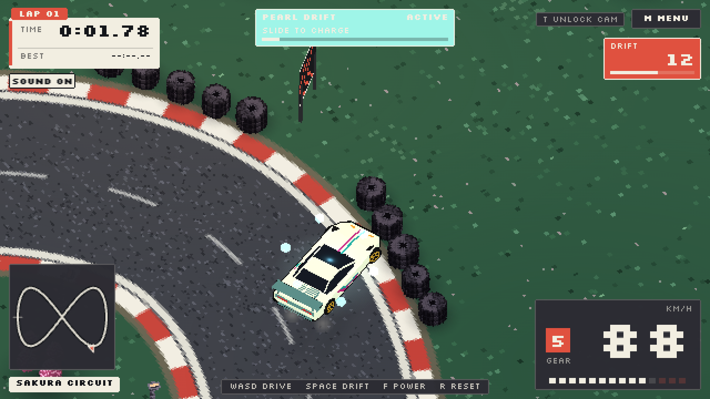
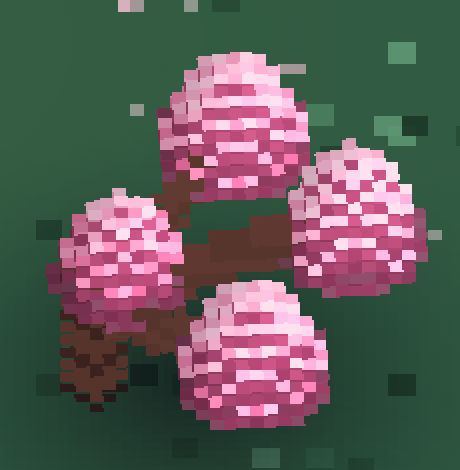
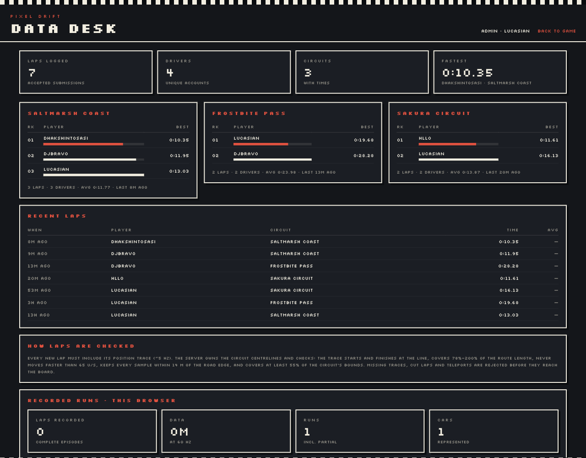

# Pixel Drift

A 2D pixel sprite art racer with powers. Every car, tree and building is a
**sprite stack** — a pile of flat pixel slices drawn one pixel apart — so the
2D sprites turn like 3D models. Three circuits, three cars, one superpower
each, real accounts and a leaderboard that refuses to believe your shortcuts.

Play it live at **[drift.lucasian.tech](https://drift.lucasian.tech)** (it runs
off my laptop, so it's up when the laptop is).


| | |
| --- | --- |
|  |  |
|  |  |

## WHY THIS EXISTS

I wanted a 3D-looking racer that could run in a browser tab without downloading
a single 3D model — everything generated in code, everything on one pixel grid.
The sprite-stack trick became the whole identity of the game: you get real
depth, real shadows and a chase camera out of flat images.

## THE CARS AND THEIR POWERS

| Car | Power | What it does |
| --- | --- | --- |
| **Pearl GT** | Pearl Drift | 4.5s of loose rear grip, a ×3.5 drift score and a boost on exit; 8s cooldown |
| **Group B** | Thunderclap | 3.5s of ×1.5 top speed, ×2.6 acceleration and a launch burst; 7s cooldown |
| **Dune Runner** | Tunnel | Time stops and you place the car anywhere within 22 m — across the apex, over a kerb, wherever; 9s cooldown |


## THREE CIRCUITS

| | |
| --- | --- |
| **Saltmarsh Coast** — green, a lake, pines and palms | **Frostbite Pass** — a big snow circuit with blue kerbs and a wide infield hairpin, snow pines, a frozen lake with ice huts, a ski lift, snow cannons and falling snow |
|  |  |
| **Sakura Circuit** — a Japanese forest figure-eight with sakura trees, kanji signage, torii, a pagoda, a red garden bridge and a drivable overpass | |
|  | |

Pick a circuit on the title screen, or link straight to one:
`?map=coast|alpine|sakura`. Same trick for cars: `?car=0|1|2`.




## HOW THIS WAS MADE

- **TypeScript + three.js** for the game; every sprite is a vertical atlas of
  slices that `src/stack.ts` draws as offset planes with nearest-neighbour
  sampling.
- **The art is authored in code**: `scripts/gen-assets.mjs` describes each
  object as four orthographic views (top/side/front/back); a voxel exists only
  where all four agree, then the volume is emitted slice by slice. Everything
  renders at 360 lines and upscales, so world, cars and HUD share one pixel
  grid.
- **The server is plain Node** — no framework, an HTTP API on `127.0.0.1:8790`
  with a JSON file store, sessions, a leaderboard, and a lap validator that
  checks every submission against the real circuit geometry. Vite proxies
  `/api` to it.
- **It runs itself**: two systemd user services (web + API) and a Cloudflare
  tunnel put the whole thing on the public internet from my laptop.

## PROBLEMS I HAD TO FIX

- **Impossible leaderboard times.** Friends were posting laps faster than the
  car's top speed could explain. I measured the track geometry and found the
  circuit passes within 18.2 m of itself at three places — exactly the
  off-road tolerance the anti-cheat allowed — so a driver could cross between
  two branches and skip 71 to 152 m of road while every sample still looked
  "near the track". Fixed in the world (tyre walls across all three crossings)
  and in the validator (a lap now has to come near every stretch of the
  circuit, not just 90% of its bounding box).
- **The anti-cheat flagged the one honest teleport.** Dune Runner's TUNNEL
  placement marks the lap trace, and the validator dropped the whole segment
  after the mark — so every blink cost the lap ~14 m of credit and perfect
  TUNNEL laps died as "route too short". The fix was one line: count the
  segment leaving the mark, capped at one sample of rolling.
- **Laps that disappeared.** A lap posted while the connection dropped was
  gone forever — no record, nothing on the board, only a 2.2-second warning.
  Now the browser keeps any unsent lap in localStorage and re-posts it after
  the next save or sign-in; rejections still stick (they got their answer).

## RUN IT

```sh
# 1. clone the repo
git clone https://github.com/lucasian-max/pixel-drift.git && cd pixel-drift

# 2. install
npm install

# 3. start the API (accounts, leaderboard, lap validator)
npm run api        # 127.0.0.1:8790

# 4. start the game (in another terminal)
npm run dev        # http://127.0.0.1:5180

# or build the production bundle
npm run build

# or run the test suite (validator fixtures + car stats)
npm test
```

The game runs without the API — you just can't save lap times.

### Controls

| Action | Keys |
| --- | --- |
| Drive | WASD / arrows |
| Handbrake drift | Space |
| Superpower | F |
| Look around | Q / E or drag |
| Re-lock the chase camera | T |
| Zoom | mouse wheel |
| Pick car / circuit on the title | Up/Down, Left/Right |
| Swap car at the start line | C |
| Back to the title | M |
| Reset | R |
| Pause | P or Esc |
| Mute | N |

## ACCOUNTS AND THE LEADERBOARD

Sign in on the title screen to post times. Each circuit keeps one best lap per
player, top 10 on the board. Nothing is trusted: every submission carries the
recorded position trace, and the server replays it against its own copy of the
circuit before the time counts — it must start and finish at the line, cover
the route, stay near the road and never exceed a speed any car can reach. Cuts,
teleports and edited clocks are rejected with a reason, and the reason is shown
to the player, not just logged.

Admins (from `SPRITE_ADMINS` or `server/data/admins.json`) get an **ADMIN**
panel for deleting a time or clearing a board, and a **DASHBOARD** at
`/dashboard.html`. Details: [`server/README.md`](server/README.md).




## AI DISCLOSURE

This project used AI heavily, and here is exactly where:

- most of the code — the game, the server, the anti-cheat and the tooling —
  was written with AI coding agents;
- the maths-heavy debugging was AI-assisted: measuring the circuit geometry
  that proved the corner-cut, working out why TUNNEL laps were rejected,
  building the validator tests;
- the screenshots in this README were captured headlessly in a browser by an
  agent told where to stand the car.

The design is mine — the three cars, the powers, the circuits, the HUD, what
stays and what gets cut — and every lap on my board was driven by a human.
