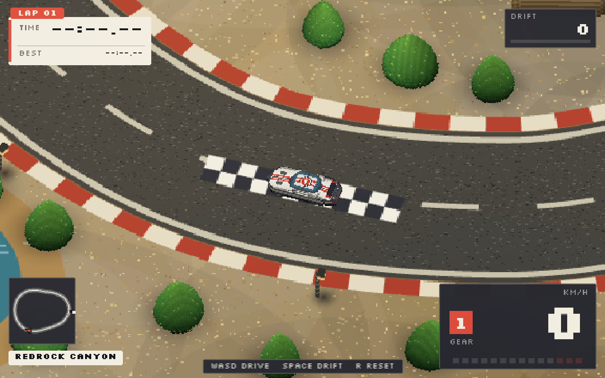
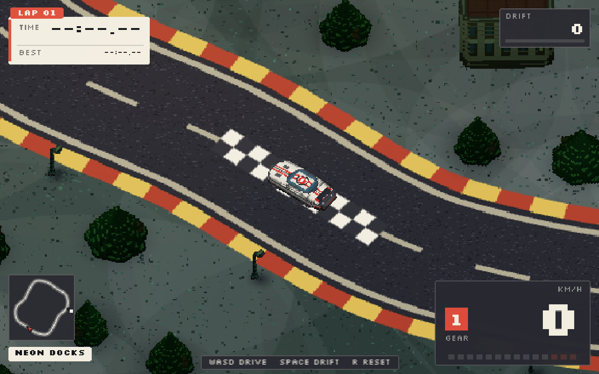
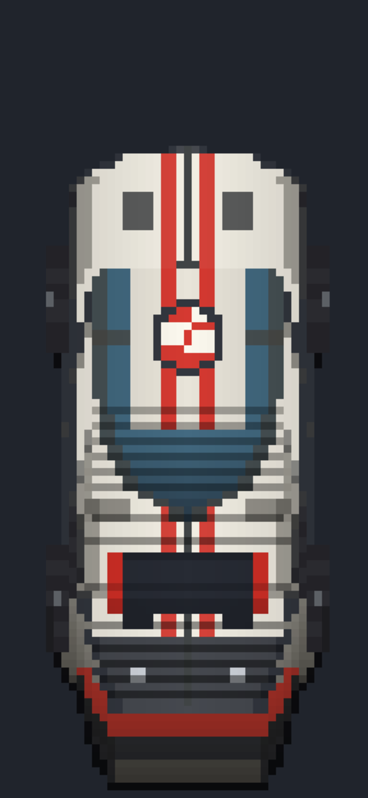

# Sprite Drift

A pixel-art racer built on **sprite stacking**: every car and prop is a stack of
flat pixel slices drawn one pixel apart, so a 2D sprite turns like a 3D model.


## Play

```bash
npm install
npm run dev      # http://127.0.0.1:5180
```

| Action | Keys |
| --- | --- |
| Drive | WASD / arrows |
| Handbrake drift | Space |
| Look around | Q / E or drag |
| Zoom | mouse wheel |
| Reset | R |
| Pause | P or Esc |
| Mute | M |

## Online rooms — archived

Multiplayer is mothballed for this release. The complete implementation is on
the `multiplayer` branch and `multiplayer-archive` tag (see
[`docs/multiplayer.md`](docs/multiplayer.md)); the shipped build is solo only.

## Accounts and leaderboard

Sign in on the title to post lap times. The board is the best clean lap per
player, top 10. Every submission carries a 5 Hz position trace; the API rejects
laps that leave the road, cut the infield, teleport, or cover the circuit
impossibly fast. A dirty lap never reaches the board.

The API runs as a local user service on `127.0.0.1:8790` (Vite proxies `/api`
to it). Use `SPRITE_API=http://host:port` to point a dev server elsewhere. See
[`server/README.md`](server/README.md).

## Four circuits

| | |
| --- | --- |
| **Saltmarsh Coast** — green, a lake, pines and palms | **Redrock Canyon** — sand, red kerbs, sparse pines |
|  |  |
| **Neon Docks** — dark, tight, yellow kerbs | **Frostbite Pass** — snow, blue kerbs, white pines |
|  |  |

Pick a circuit on the title screen with the arrows, or link straight to one:
`?map=coast|canyon|night|alpine`.

## The cars

Ten machines, carved from four flat views each. The hero is a pearl-white GT
with a twin racing stripe, a roof roundel, framed glass, mirrors, vented bonnet,
a ducktail spoiler and chrome exhausts.



Others include a taxi, a police car, a pizza van, a pickup, a sofa and a hot dog.

## How the art works

`scripts/gen-assets.mjs` authors each object as four orthographic views
(top, side, front, back). A voxel exists only where all four agree: the top face
takes the top view's colour, and exposed side faces take the colour of the view
they face. The volume is emitted as a vertical atlas — one slice per pixel of
height — which `src/stack.ts` draws as offset planes with nearest-neighbour
sampling.

Everything renders at 360 lines and is upscaled, so the world, the cars and the
HUD share one pixel grid.

```bash
npm run assets    # regenerate every sprite + flattened previews
npm run build     # typecheck + production build
```
